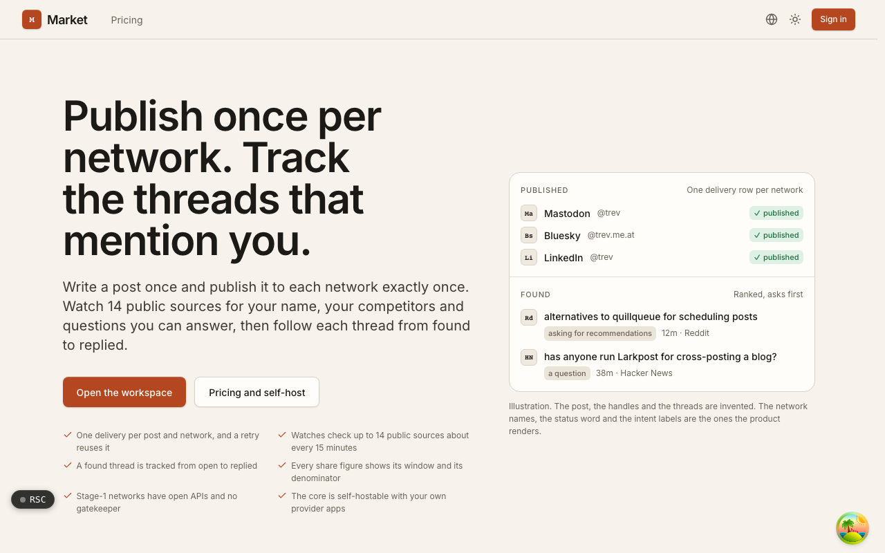

  <picture>
    <source media="(prefers-color-scheme: dark)" srcset=".github/assets/hero-dark.png">
    
  </picture>

# market.me.at

Publish once per network. Track the threads that mention you.

market.me.at is social-post scheduling and cross-posting with exactly-once delivery: compose a post once, preview it against each network's real constraints, schedule it, and publish through per-network drivers so a retry never double-posts to a real audience. It also listens: watches check public sources for your name, your competitors and questions you can answer, and you follow each thread from found to replied.

## Features

- **Compose once, preview per network**: one text box with a preview for each connected network, checked against that network's own limits (weighted length, media, links) before anything is scheduled.
- **Exactly-once publishing**: one delivery record per post and network, so a retry updates that record and never posts a second time.
- **Scheduling and posting rhythm**: pick a time, or add a post to a network's queue and let declared posting slots place it.
- **Many destinations**: Mastodon, Bluesky, LinkedIn, Ghost, WordPress, dev.to and Forem, Discord and Slack webhooks, and an owned RSS feed.
- **Listening**: watches read public sources (RSS, Google News, Reddit and others) about every 15 minutes, and a ranked feed puts questions above chatter.
- **Places**: save a thread, answer it in your own voice, and mark it replied with a link to what you said. Nothing is posted for you.
- **Campaigns, analytics and benchmark**: group posts under a goal, read delivery and engagement per channel, and see share of voice against competitors, with every figure showing what it was counted from.
- **Guardrails**: approvals that expire when the post changes, a pre-publish link check, and daily caps that protect provider standing.

## Built with

- Next.js 16 (App Router), React 19, TypeScript
- Tailwind CSS 4
- Drizzle ORM + Postgres
- Better Auth
- oRPC + TanStack Query
- Per-network provider drivers behind one contract
- Optional AI analysis: Anthropic or a local model

## Part of the me.at family

market.me.at is one of my [`*.me.at`](https://me.at) apps. They share one design system, account, and app shell. Development happens in a private monorepo; this repository is the project's public-facing home.

## License

See [LICENSE](LICENSE).
